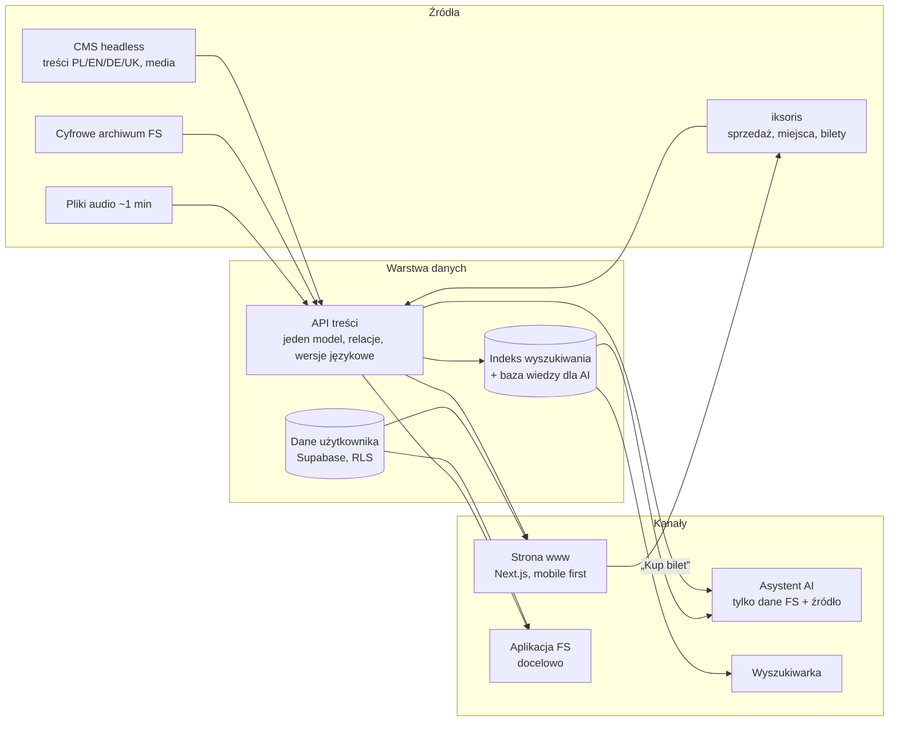

# Architektura, mapa serwisu i model treści

Rezultaty briefu §10 pkt 3 i 4 oraz kryteria „Architektura i skalowalność” (15%) i „Wykonalność wdrożenia” (10%).
Stan na 18.10.2026. Legenda statusu: **działa** (kod w repo), **mock** (dane lokalne lub atrapa), **docelowo** (poza prototypem).

## 1. Zasada: jedno API, wiele kanałów

Żaden kanał (strona, asystent, wyszukiwarka, przyszła aplikacja) nie czyta bezpośrednio z CMS ani z systemu biletowego. Wszystkie korzystają z jednej warstwy danych.



## 2. Co jest prawdziwe, a co jest makietą

| Element | Stan w prototypie | Docelowo | Punkt integracji w kodzie |
|---|---|---|---|
| Wydarzenia, artyści, cykle | **działa** na `src/data/koncerty.json` (90 wydarzeń, scraper `ScrappedData/scraper/build-json.mjs`) | CMS headless (Strapi/Sanity/Payload/Directus) | `src/lib/events.ts`, `src/lib/artists.ts` |
| API wydarzeń | **działa**: `GET /api/events` (te same filtry co URL), `/api/events/[id]`, `/api/events/[id]/ics` | rozszerzenie o artystów, utwory, wystawy, FAQ | `src/app/api/events/**` |
| Status biletów, ceny | **mock** (`src/content/availability.ts`) | API iksoris: status, cena od–do, plan sali | `src/content/availability.ts` → klient iksoris |
| Zakup biletu | **link** do sklepu FS (`tickets_url`), bez płatności | iksoris, koszyk w 2 krokach | przyciski „Kup bilet” |
| Odsłuch fragmentów | **mock** (`src/content/audio.ts`, próbka demo) | pliki FS lub platforma streamingowa, interfejs niezależny od dostawcy | `src/components/event/fragment-player.tsx` |
| Asystent AI | **działa**: model LLM z gotowym `briefing` wydarzeń, odpowiedź strukturalna (tekst + karty + źródło), brak wiedzy → kasa | RAG po indeksie (FAQ, treści, archiwum) | `src/app/api/chat/route.ts`, `src/lib/assistant.ts` |
| Wyszukiwarka | **działa** lokalnie: grupy wyników, tolerancja polskich znaków, intencje po polsku | Meilisearch/Typesense, semantyka, EN/DE/UK | `src/lib/search.ts` |
| Konto, ulubione, historia czatu | **działa**: Supabase Auth + tabele z RLS | + bilety z iksoris, powiadomienia, program lojalnościowy | `supabase/migrations`, `src/app/[lang]/panel/**` |
| Newsletter | **działa**: zapis do Supabase | CRM, segmentacja wg zainteresowań, zgody | `src/app/api/newsletter/route.ts` |
| Analityka | **działa** po zgodzie: PostHog i Vercel Analytics, baner zgód, zmiana zgody w stopce | bez zmian, konfiguracja po stronie FS | `src/lib/analytics.ts`, `src/lib/consent.ts` |
| SEO | **działa**: `schema.org` (Event, Organization, WebSite), sitemap z hreflang, `robots` | bez zmian | `src/lib/structured-data.ts`, `src/app/sitemap.ts` |
| Języki | **działa** PL/EN/DE/UK dla interfejsu; opisy wydarzeń tylko PL poza 5 demo | pełne tłumaczenia w CMS (pole per język) | `src/i18n/**` |
| Archiwum FS, mapy | **docelowo**; mapy to link do natywnej nawigacji | osadzanie lub linkowanie archiwum | — |

Dane bez wpisu w CMS nie blokują strony: moduły czytają z jednego miejsca, więc podmiana źródła dotyczy `src/lib/events.ts` i `src/content/*`, nie komponentów.

## 3. Mapa serwisu

Wszystkie ścieżki mają prefiks języka (`/pl`, `/en`, `/de`, `/uk`). Każda treść jest osiągalna z menu w ≤ 2 krokach. Zawsze widoczne: Szukaj, Asystent AI, Kup bilet, przełącznik języka.

```
/                              Strona główna (hero, Dziś w Filharmonii, Najbliższe, Polecamy, Dla Ciebie, Odkryj, newsletter)
├── Repertuar
│   ├── /repertuar             Kalendarz z filtrami
│   ├── /wydarzenia/[slug]     Karta wydarzenia (CO, KIEDY, GDZIE, ZA ILE, DLA KOGO, Kup bilet)
│   └── /cykl/[key]            Cykl i festiwal jako podstrona serwisu
├── Dla Ciebie
│   ├── /zacznij-tutaj         Ścieżka debiutanta
│   ├── /pomoz-mi-wybrac       Kreator: 5 pytań → 3–5 propozycji
│   └── /asystent              Asystent AI (+ nakładka z każdej strony)
├── /edu                       EDUfilharmonia
├── Odkryj Filharmonię
│   ├── /orkiestra
│   ├── /artysci, /artysci/[slug]
│   ├── /budynek
│   ├── /historia
│   ├── /wystawy
│   └── /zwiedzanie
├── /planuj-wizyte             Bilety, dojazd, szatnia, dostępność, FAQ
├── Moje konto
│   ├── /auth/login, /auth/register
│   └── /panel                 Ulubione, historia czatu, profil
├── /szukaj                    Wyszukiwarka
└── Stopka
    ├── /partnerzy             Partnerzy i biznes
    ├── /media                 Strefa mediów
    ├── /kontakt
    ├── /o-instytucji
    └── /deklaracja-dostepnosci
```

Inne: `/api/events`, `/api/chat`, `/api/newsletter`, `/sitemap.xml`, `/robots.txt`. Wydarzenie EDU jest jednym rekordem widocznym w kalendarzu i w `/edu` (tagi zamiast kopii).

## 4. Model treści

Treści są powiązanymi obiektami, nie stronami. Kolumna „W prototypie” wskazuje, gdzie dane są dziś.

| Typ | Kluczowe pola | Relacje | W prototypie |
|---|---|---|---|
| Wydarzenie | tytuł, terminy, sala, czas trwania, przerwa, cena od–do, typ, grupa docelowa, wiek, nastrój, „dlaczego warto”, dostępność, status biletów, link zakupu, PDF programu | artyści, utwory, cykl/festiwal, miejsce | `koncerty.json` (+ cechy liczone w `lib/calendar.ts`); nastroje i status biletów redakcyjnie / mock |
| Artysta | imię i nazwisko, rola, biogram, zdjęcie | wydarzenia, nagrania, orkiestra | `artysci.json` |
| Utwór | tytuł, kompozytor, czas, fragment audio | wydarzenia, nagrania | pole `program` wydarzenia; audio mock |
| Cykl, festiwal | nazwa, sezon, opis, karnety | wydarzenia | `cykle.json` |
| Wystawa | tytuł, daty, galeria, artyści, kurator, wernisaż | miejsce | wydarzenia typu `wystawa` |
| Oferta edukacyjna | grupa, wiek, sposób zapisu, korzyść | wydarzenia | wydarzenia EDU + `listing-routes` |
| Miejsce | sala lub galeria, plan, dostępność | wydarzenia | `meta.venue_info`, `visit.json` |
| Artykuł, historia | tekst, media, data, tagi | artyści, wydarzenia | `content/about.ts` |
| FAQ | pytanie, odpowiedź, kategoria | źródło wiedzy dla AI | `visit.json`, „Planuj wizytę” |
| Użytkownik | profil, język, zgody | ulubione, historia czatu, powiadomienia | Supabase: `profiles`, `favorites`, `chat_sessions`, `chat_messages`, `event_notifications`, `newsletter_subscribers` |

Wymagania przekrojowe: każdy typ ma wersje PL/EN/DE/UK (treść, nie tylko menu) i pola SEO (tytuł, opis, slug, obraz).

## 5. Kontrakt API (propozycja dla wykonawcy)

| Endpoint | Metoda | Rola | Stan |
|---|---|---|---|
| `/api/events` | GET | lista po filtrach: `kiedy, od, do, rodzaj, dla-kogo, wiek, miejsce, czas, nastroj, cykl, q, lang` | **działa** |
| `/api/events/{id}` | GET | karta wydarzenia | **działa** |
| `/api/events/{id}/ics` | GET | plik kalendarza | **działa** |
| `/api/events/{id}/availability` | GET | status i ceny z iksoris | docelowo (dziś mock) |
| `/api/artists`, `/api/artists/{slug}` | GET | profile i powiązane wydarzenia | docelowo |
| `/api/search?q=` | GET | wyniki grupowane: wydarzenia, artyści, utwory, materiały | docelowo (dziś lokalnie) |
| `/api/chat` | POST | asystent (strumień: odpowiedź, karty, źródło) | **działa** |
| `/api/me/favorites`, `/api/me/tickets`, `/api/me/notifications` | GET/POST | panel klienta | ulubione **działa** (Supabase); bilety i powiadomienia **mock** (`content/tickets.ts`, `panel/notifications.ts`) |

Ta sama warstwa ma zasilać przyszłą aplikację FS (bilety, panel klienta).

## 6. Wydajność i skalowalność

- **Next.js 16, renderowanie częściowo statyczne**: strony z treścią wstępnie renderowane, dane dynamiczne dociągane strumieniowo. Kalendarz liczy filtry po stronie przeglądarki, więc zmiana filtra nie obciąża serwera.
- **Szczyt w dniu startu sprzedaży**: strona jest statyczna za CDN; jedyne obciążone punkty to `/api/chat` (limit zapytań, koszt modelu) i przekierowanie do iksoris. `/api/chat` ma limit 20 zapytań na 10 minut z adresu (`src/lib/rate-limit.ts`, w pamięci instancji – na produkcji wspólny magazyn, np. Redis/KV). Brakuje jeszcze cache odpowiedzi na typowe pytania.
- **Cel mobilny** (design.md): LCP, CLS i INP do zmierzenia na 360 px, wartości docelowe w `docs/design.md`. Pomiaru jeszcze nie ma (TODO P2).
- Zdjęcia: `object-fit`, `srcset`, leniwe ładowanie poza pierwszym ekranem; wideo bez dźwięku i bez autoodtwarzania przy `prefers-reduced-motion`.

## 7. RODO i bezpieczeństwo

- Analityka tylko po zgodzie; zgodę można zmienić w stopce („Ustawienia prywatności”).
- Dane użytkownika w Supabase z Row Level Security (użytkownik widzi tylko swoje wiersze).
- Asystent: nota o braku danych osobowych w rozmowie, odpowiedzi tylko z danych FS.
- **Do rozstrzygnięcia z FS:** brief wymaga asystenta „bez logowania rozmów”, a prototyp zapisuje historię czatu zalogowanych użytkowników (`chat_sessions`, `chat_messages`) na potrzeby panelu. Trzeba wybrać: wyłączyć zapis albo opisać go w polityce prywatności z możliwością usunięcia.
- Dane panelu: czy przechowuje je iksoris czy CMS/Supabase (pytanie otwarte z briefu §6.6).
- HTTPS, brak sekretów w kodzie klienta (klucze w zmiennych środowiskowych).

## 8. Plan wdrożenia dla wykonawcy

| Etap | Zakres | Zależność od FS |
|---|---|---|
| 1. Treści | wybór CMS, model z §4, import z `koncerty.json`, role redakcyjne, podgląd i wersjonowanie | wybór CMS, tłumaczenia opisów |
| 2. Bilety | klient iksoris: status, ceny, plan sali; „Kup bilet” w 2 krokach | dostęp do API iksoris |
| 3. Wyszukiwarka i AI | indeks (Meilisearch/Typesense), RAG po FAQ i treściach, limity | decyzja o zapisie rozmów |
| 4. Konto | bilety, programy PDF, powiadomienia, newsletter z segmentacją | decyzja, kto przechowuje dane |
| 5. Media | audio (pliki lub streaming), archiwum, zdjęcia z licencjami | pliki, licencje, logo SVG |
| 6. Wydajność i dostępność | pomiar LCP/CLS/INP, testy z VoiceOver/TalkBack, zoom 200% | — |
| 7. Aplikacja FS | ta sama warstwa API | — |

Ryzyka: jakość i licencje materiałów FS, dostępność API iksoris, koszt i limity LLM przy szczycie ruchu, pełne tłumaczenia treści (dziś ~85 opisów tylko po polsku).
