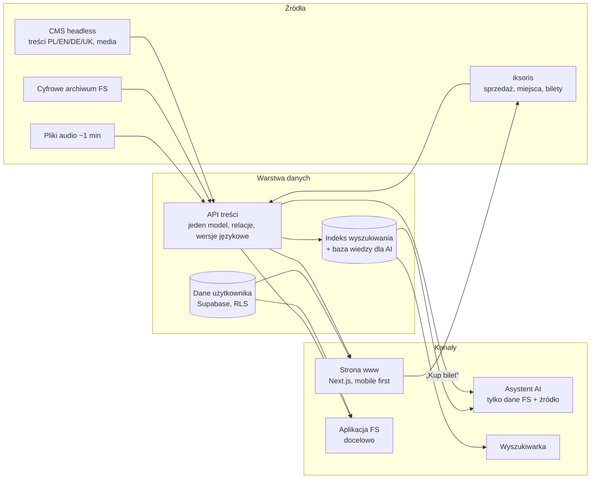

# Architektura, mapa serwisu i model treści

Rezultaty briefu §10 pkt 3 i 4 oraz kryteria „Architektura i skalowalność” (15%) i „Wykonalność wdrożenia” (10%).
Stan na 18.10.2026. Legenda statusu: **działa** (kod w repo), **mock** (dane lokalne lub atrapa), **docelowo** (poza prototypem).

## 1. Zasada: jedno API, wiele kanałów

Żaden kanał (strona, asystent, wyszukiwarka, przyszła aplikacja) nie czyta bezpośrednio z CMS ani z systemu biletowego. Wszystkie korzystają z jednej warstwy danych.



## 2. Co jest prawdziwe, a co jest makietą

| Element | Stan w prototypie | Docelowo | Punkt integracji w kodzie |
|---|---|---|---|
| Wydarzenia, artyści, cykle | **działa** na `src/data/koncerty.json` (90 wydarzeń, scraper `ScrappedData/scraper/build-json.mjs`) | CMS headless (Strapi/Sanity/Payload/Directus) | `src/lib/events.ts`, `src/lib/artists.ts` |
| API wydarzeń | **działa**: `GET /api/events` (te same filtry co URL), `/api/events/[id]`, `/api/events/[id]/ics` | rozszerzenie o artystów, utwory, wystawy, FAQ | `src/app/api/events/**` |
| Status biletów, ceny | **mock** (`src/content/availability.ts`) | API iksoris: status, cena od–do, plan sali | `src/content/availability.ts` → klient iksoris |
| Zakup biletu | **link** do sklepu FS (`tickets_url`), bez płatności | iksoris, koszyk w 2 krokach | przyciski „Kup bilet” |
| Odsłuch fragmentów | **mock** (`src/content/audio.ts`, próbka demo) | pliki FS lub platforma streamingowa, interfejs niezależny od dostawcy | `src/components/event/fragment-player.tsx` |
| Asystent AI | **działa**: model LLM z gotowym `briefing` wydarzeń, odpowiedź strukturalna (tekst + karty + źródło), brak wiedzy → kasa | RAG po indeksie (FAQ, treści, archiwum) | `src/app/api/chat/route.ts`, `src/lib/assistant.ts` |
| Wyszukiwarka | **działa** lokalnie: grupy wyników, tolerancja polskich znaków, intencje po polsku | Meilisearch/Typesense, semantyka, EN/DE/UK | `src/lib/search.ts` |
| Konto, ulubione, historia czatu | **działa**: Supabase Auth + tabele z RLS | + bilety z iksoris, powiadomienia, program lojalnościowy | `supabase/migrations`, `src/app/[lang]/panel/**` |
| Newsletter | **działa**: zapis do Supabase | CRM, segmentacja wg zainteresowań, zgody | `src/app/api/newsletter/route.ts` |
| Analityka | **działa** po zgodzie: PostHog i Vercel Analytics, baner zgód, zmiana zgody w stopce | bez zmian, konfiguracja po stronie FS | `src/lib/analytics.ts`, `src/lib/consent.ts` |
| SEO | **działa**: `schema.org` (Event, Organization, WebSite), sitemap z hreflang, `robots` | bez zmian | `src/lib/structured-data.ts`, `src/app/sitemap.ts` |
| Języki | **działa** PL/EN/DE/UK dla interfejsu; opisy wydarzeń tylko PL poza 5 demo | pełne tłumaczenia w CMS (pole per język) | `src/i18n/**` |
| Archiwum FS, mapy | **docelowo**; mapy to link do natywnej nawigacji | osadzanie lub linkowanie archiwum | — |

Dane bez wpisu w CMS nie blokują strony: moduły czytają z jednego miejsca, więc podmiana źródła dotyczy `src/lib/events.ts` i `src/content/*`, nie komponentów.

## 3. Mapa serwisu

Wszystkie ścieżki mają prefiks języka (`/pl`, `/en`, `/de`, `/uk`). Każda treść jest osiągalna z menu w ≤ 2 krokach. Zawsze widoczne: Szukaj, Asystent AI, Kup bilet, przełącznik języka.

```
/                              Strona główna (hero, Dziś w Filharmonii, Najbliższe, Polecamy, Dla Ciebie, Odkryj, newsletter)
├── Repertuar
│   ├── /repertuar             Kalendarz z filtrami
│   ├── /wydarzenia/[slug]     Karta wydarzenia (CO, KIEDY, GDZIE, ZA ILE, DLA KOGO, Kup bilet)
│   └── /cykl/[key]            Cykl i festiwal jako podstrona serwisu
├── Dla Ciebie
│   ├── /zacznij-tutaj         Ścieżka debiutanta
│   ├── /pomoz-mi-wybrac       Kreator: 5 pytań → 3–5 propozycji
│   └── /asystent              Asystent AI (+ nakładka z każdej strony)
├── /edu                       EDUfilharmonia
├── Odkryj Filharmonię
│   ├── /orkiestra
│   ├── /artysci, /artysci/[slug]
│   ├── /budynek
│   ├── /historia
│   ├── /wystawy
│   └── /zwiedzanie
├── /planuj-wizyte             Bilety, dojazd, szatnia, dostępność, FAQ
├── Moje konto
│   ├── /auth/login, /auth/register
│   └── /panel                 Ulubione, historia czatu, profil
├── /szukaj                    Wyszukiwarka
└── Stopka
    ├── /partnerzy             Partnerzy i biznes
    ├── /media                 Strefa mediów
    ├── /kontakt
    ├── /o-instytucji
    └── /deklaracja-dostepnosci
```

Inne: `/api/events`, `/api/chat`, `/api/newsletter`, `/sitemap.xml`, `/robots.txt`. Wydarzenie EDU jest jednym rekordem widocznym w kalendarzu i w `/edu` (tagi zamiast kopii).

## 4. Model treści

Treści są powiązanymi obiektami, nie stronami. Kolumna „W prototypie” wskazuje, gdzie dane są dziś.

| Typ | Kluczowe pola | Relacje | W prototypie |
|---|---|---|---|
| Wydarzenie | tytuł, terminy, sala, czas trwania, przerwa, cena od–do, typ, grupa docelowa, wiek, nastrój, „dlaczego warto”, dostępność, status biletów, link zakupu, PDF programu | artyści, utwory, cykl/festiwal, miejsce | `koncerty.json` (+ cechy liczone w `lib/calendar.ts`); nastroje i status biletów redakcyjnie / mock |
| Artysta | imię i nazwisko, rola, biogram, zdjęcie | wydarzenia, nagrania, orkiestra | `artysci.json` |
| Utwór | tytuł, kompozytor, czas, fragment audio | wydarzenia, nagrania | pole `program` wydarzenia; audio mock |
| Cykl, festiwal | nazwa, sezon, opis, karnety | wydarzenia | `cykle.json` |
| Wystawa | tytuł, daty, galeria, artyści, kurator, wernisaż | miejsce | wydarzenia typu `wystawa` |
| Oferta edukacyjna | grupa, wiek, sposób zapisu, korzyść | wydarzenia | wydarzenia EDU + `listing-routes` |
| Miejsce | sala lub galeria, plan, dostępność | wydarzenia | `meta.venue_info`, `visit.json` |
| Artykuł, historia | tekst, media, data, tagi | artyści, wydarzenia | `content/about.ts` |
| FAQ | pytanie, odpowiedź, kategoria | źródło wiedzy dla AI | `visit.json`, „Planuj wizytę” |
| Użytkownik | profil, język, zgody | ulubione, historia czatu, powiadomienia | Supabase: `profiles`, `favorites`, `chat_sessions`, `chat_messages`, `event_notifications`, `newsletter_subscribers` |

Wymagania przekrojowe: każdy typ ma wersje PL/EN/DE/UK (treść, nie tylko menu) i pola SEO (tytuł, opis, slug, obraz).

## 5. Kontrakt API (propozycja dla wykonawcy)

| Endpoint | Metoda | Rola | Stan |
|---|---|---|---|
| `/api/events` | GET | lista po filtrach: `kiedy, od, do, rodzaj, dla-kogo, wiek, miejsce, czas, nastroj, cykl, q, lang` | **działa** |
| `/api/events/{id}` | GET | karta wydarzenia | **działa** |
| `/api/events/{id}/ics` | GET | plik kalendarza | **działa** |
| `/api/events/{id}/availability` | GET | status i ceny z iksoris | docelowo (dziś mock) |
| `/api/artists`, `/api/artists/{slug}` | GET | profile i powiązane wydarzenia | docelowo |
| `/api/search?q=` | GET | wyniki grupowane: wydarzenia, artyści, utwory, materiały | docelowo (dziś lokalnie) |
| `/api/chat` | POST | asystent (strumień: odpowiedź, karty, źródło) | **działa** |
| `/api/me/favorites`, `/api/me/tickets`, `/api/me/notifications` | GET/POST | panel klienta | ulubione **działa** (Supabase); bilety i powiadomienia **mock** (`content/tickets.ts`, `panel/notifications.ts`) |

Ta sama warstwa ma zasilać przyszłą aplikację FS (bilety, panel klienta).

## 6. Wydajność i skalowalność

- **Next.js 16, renderowanie częściowo statyczne**: strony z treścią wstępnie renderowane, dane dynamiczne dociągane strumieniowo. Kalendarz liczy filtry po stronie przeglądarki, więc zmiana filtra nie obciąża serwera.
- **Szczyt w dniu startu sprzedaży**: strona jest statyczna za CDN; jedyne obciążone punkty to `/api/chat` (limit zapytań, koszt modelu) i przekierowanie do iksoris. `/api/chat` ma limit 20 zapytań na 10 minut z adresu (`src/lib/rate-limit.ts`, w pamięci instancji – na produkcji wspólny magazyn, np. Redis/KV). Brakuje jeszcze cache odpowiedzi na typowe pytania.
- **Cel mobilny** (`docs/design.md` §11): LCP < 2 500 ms, CLS < 0,1, INP < 200 ms. Pomiar w Chrome headless przy 360 × 780 px (emulacja 4G + dławienie 4× CPU, `PerformanceObserver`, 18.10.2026):

| Widok (360 px) | LCP (cel < 2 500 ms) | CLS (cel < 0,1) | INP (cel < 200 ms) |
|---|---|---|---|
| `/` (Strona główna) | **280 ms** (`img` hero) | **0,000** | **32 ms** |
| `/repertuar` (Kalendarz) | **540 ms** | **0,000** | **136 ms** (przełączenie widoku) |
| `/wydarzenia/2608-…` (Karta wydarzenia) | **512 ms** (`img` karty) | **0,000** | **16 ms** |
| `/pomoz-mi-wybrac` (Kreator) | **376 ms** | **0,000** | **≤ 32 ms** |
| `/planuj-wizyte` (Planuj wizytę) | **384 ms** | **0,000** | **16 ms** |

- Zdjęcia: `object-fit`, `srcset`, `priority` / `fetchpriority="high"` na obrazie otwarcia i karty wydarzenia, leniwe ładowanie poza pierwszym ekranem; wideo bez dźwięku i bez autoodtwarzania przy `prefers-reduced-motion`.

## 7. RODO i bezpieczeństwo

- Analityka (PostHog w przeglądarce i na serwerze `/api/chat` oraz Vercel Analytics) uruchamia się wyłącznie po wyborze „Akceptuj” w banerze (`localStorage["fs-consent"] = "analytics"`). Zgodę można w każdej chwili zmienić lub wycofać przyciskiem „Ustawienia prywatności” (`#ustawienia-prywatnosci`) w stopce – fokus trafia na pole wyboru, a po zapisie wraca na przycisk w stopce.
- Dane użytkownika w Supabase z Row Level Security (użytkownik widzi tylko swoje wiersze).
- Asystent: widoczna nota RODO z linkiem do polityki prywatności, zakaz proszenia o dane osobowe i ich powtarzania w instrukcji systemowej modelu (`src/lib/assistant.ts`) oraz `privacyMode: true` w kliencie PostHog AI (treść rozmowy nie trafia do logów analitycznych).
- **Ograniczenia prototypu / do rozstrzygnięcia z FS:** zgoda jest pamiętana lokalnie w `localStorage` (brak serwerowego rejestru zgód); w bazie istnieją tabele `chat_sessions` / `chat_messages` pod historię w panelu klienta, natomiast publiczny `/api/chat` nie zapisuje rozmów w bazie. Przed wdrożeniem trzeba zdecydować z FS, czy historia czatu dla zalogowanych ma być wyłączona (zgodnie z „bez logowania” z briefu §6.5), czy opisana w polityce prywatności jako opcja konta z usuwaniem.
- Dane panelu: czy przechowuje je iksoris czy CMS/Supabase (pytanie otwarte z briefu §6.6).
- HTTPS, brak sekretów w kodzie klienta (klucze w zmiennych środowiskowych).

## 8. Plan wdrożenia dla wykonawcy

| Etap | Zakres | Zależność od FS |
|---|---|---|
| 1. Treści | wybór CMS, model z §4, import z `koncerty.json`, role redakcyjne, podgląd i wersjonowanie | wybór CMS, tłumaczenia opisów |
| 2. Bilety | klient iksoris: status, ceny, plan sali; „Kup bilet” w 2 krokach | dostęp do API iksoris |
| 3. Wyszukiwarka i AI | indeks (Meilisearch/Typesense), RAG po FAQ i treściach, limity | decyzja o zapisie rozmów |
| 4. Konto | bilety, programy PDF, powiadomienia, newsletter z segmentacją | decyzja, kto przechowuje dane |
| 5. Media | audio (pliki lub streaming), archiwum, zdjęcia z licencjami | pliki, licencje, logo SVG |
| 6. Wydajność i dostępność | pomiar LCP/CLS/INP (zrobione w §6), powiększenie 200% i AXTree (zrobione), testy z fizycznym VoiceOver/TalkBack | — |
| 7. Aplikacja FS | ta sama warstwa API | — |

Ryzyka: jakość i licencje materiałów FS, dostępność API iksoris, koszt i limity LLM przy szczycie ruchu, pełne tłumaczenia treści (dziś ~85 opisów tylko po polsku).

## 9. Paczka wdrożeniowa: makiety układów 360 px / 1440 px i indeks dokumentacji

Wszystkie artefakty dla zespołu wdrożeniowego w jednym miejscu:

- **System projektowy i zasady UI:** [`docs/design.md`](./design.md) (monochromatyczna paleta + złoto w nagłówkach, `border-radius: 0`, siatka 4 kolumn na 360 px i 12 kolumn na 1440 px, komponenty §6, szablony stron §7).
- **Raport dostępności WCAG 2.2 AA:** [`docs/raport-dostepnosci.md`](./raport-dostepnosci.md) (axe-core: 0 naruszeń w 38 skanach na 360 i 1440 px; klawiatura i pułapki fokusu; reflow 320 px; powiększenie 200% na 12 widokach; drzewo AXTree).
- **Scenariusze prezentacji i ścieżki użytkownika:** [`docs/prezentacja-scenariusze.md`](./prezentacja-scenariusze.md) (scenariusze A–D zweryfikowane na żywo).
- **Audyt wymagań briefu:** [`docs/audyt-wymagan.md`](./audyt-wymagan.md).

### Makiety strukturalne kluczowych widoków (360 px mobile vs 1440 px desktop)

#### 9.1. Strona główna (`/[lang]` — `src/app/[lang]/page.tsx`)

```text
360 px (4 kol., margines 16 px, dolny pasek 64 px)      1440 px (12 kol., max 1320 px, margines 32 px)
+------------------------------------+                  +------------------------------------------------------------------+
| [Logo FS]            [PL v] [Menu] | 56 px            | [Logo FS]  Repertuar  Planuj wizytę    [Szukaj] [Konto] [PL] [≡] | 72 px
+------------------------------------+                  +------------------------------------------------------------------+
| Zdjęcie otwarcia (pełna szer.)     |                  | Zdjęcie otwarcia (pełna szer., wys. 72–82 vh, ścięcie 48 px)     |
| Ciemna płyta (#1A1A1A):            |                  | +-----------------------------------+                            |
|   NADCHODZĄCY KONCERT (złoto)      |                  | | Ciemna płyta (kol. 1–6):          |                            |
|   Tytuł wydarzenia (H1, biały)     |                  | |   NADCHODZĄCY KONCERT             |                            |
|   Data · sala · od 40 zł           |                  | |   Tytuł wydarzenia (H1)           |                            |
|   [Kup bilet]  [Posłuchaj 1 min]   |                  | |   [Kup bilet] [Posłuchaj] [Zobacz]|                            |
+------------------------------------+                  +------------------------------------------------------------------+
| NAJBLIŻSZE WYDARZENIA              |                  | NAJBLIŻSZE WYDARZENIA                          Wszystkie (90) →  |
| Wiersze 1–5 (data | tytuł | status)|                  | Wiersze 1–6 w układzie poziomym (data | zdjęcie | tytuł | akcja) |
+------------------------------------+                  +------------------------------------------------------------------+
| DZIŚ W FILHARMONII (Schody #1A1A1A)|                  | DZIŚ W FILHARMONII — Schody (9 stopni diagonalnych + podgląd)    |
+------------------------------------+                  +------------------------------------------------------------------+
| POLECAMY (siatka 2 kol. kompakt)   |                  | POLECAMY (siatka 3 kart po 4 kolumny, zdjęcie 3:2 ze ścięciem)   |
+------------------------------------+                  +------------------------------------------------------------------+
| DLA CIEBIE (kafle 2×2 + kreator)   |                  | DLA CIEBIE (4 kafle po 3 kolumny + baner „Pomóż mi wybrać”)      |
+------------------------------------+                  +------------------------------------------------------------------+
| ODKRYJ FILHARMONIĘ (kafle 2×3)     |                  | ODKRYJ FILHARMONIĘ (6 kafli: EDU, Orkiestra, Budynek, Historia…)|
+------------------------------------+                  +------------------------------------------------------------------+
| Newsletter + Stopka (#1A1A1A)      |                  | Newsletter (2 kol.) + Stopka (4 kolumny linków + RODO)           |
+------------------------------------+                  +------------------------------------------------------------------+
| [Repertuar][Wizyta][AI][Szukaj][Ja]| sticky           |                                                    [Heksagon AI] |
+------------------------------------+                  +------------------------------------------------------------------+
```

#### 9.2. Repertuar i kalendarz (`/[lang]/repertuar` — `src/components/calendar/calendar.tsx`)

```text
360 px (pasek filtrów sticky pod nagłówkiem)            1440 px (filtry + przełącznik Miesiąc / Lista w jednym wierszu)
+------------------------------------+                  +------------------------------------------------------------------+
| H1: Repertuar i bilety             |                  | H1: Repertuar i bilety                     [Miesiąc] [Lista]     |
| [Miesiąc] [Lista]                  |                  +------------------------------------------------------------------+
| [Ten weekend][Symfoniczny][Filtry] | ← scroll X       | [Ten weekend][Dziś][Symfoniczny][Kameralny][Jazz][Dzieci][Filtry]|
+------------------------------------+                  +------------------------------------------------------------------+
| 90 wydarzeń · Wyczyść filtry       | aria-live        | 90 wydarzeń (aria-live="polite")                                 |
+------------------------------------+                  +------------------------------------------------------------------+
| Widok Miesiąc:                     |                  | Widok Miesiąc:                                                   |
|   Fasada 3D (7 kolumn Pn–Nd)       |                  |   Fasada 3D (7 kolumn Pn–Nd, obrót bryły przy zmianie miesiąca)  |
|   Panel wybranego dnia pod siatką  |                  |   Panel wybranego dnia z wierszami wydarzeń i „Kup bilet”        |
| Widok Lista:                       |                  | Widok Lista:                                                     |
|   Nagłówek dnia (sticky)           |                  |   Nagłówek dnia + wiersze: godzina | zdjęcie | tytuł/sala | CTA  |
|   Wiersze wydarzeń (cały klikalny) |                  +------------------------------------------------------------------+
+------------------------------------+
```

#### 9.3. Karta wydarzenia (`/[lang]/wydarzenia/[slug]` — `src/app/[lang]/wydarzenia/[slug]/page.tsx`)

```text
360 px (jedna kolumna + dolny pasek zakupu)             1440 px (kol. 1–7 treść + kol. 9–12 sticky panel zakupu)
+------------------------------------+                  +------------------------------------------------------------------+
| ← Wróć do repertuaru               |                  | Repertuar / Koncert symfoniczny / Tytuł                          |
| Zdjęcie 3:2 (ścięcie 24 px)        |                  +-----------------------------------------+------------------------+
| CYKL · RODZAJ (złoto)              |                  | Zdjęcie 3:2 (kol. 1–7, ścięcie 48 px)   | Panel zakupu (sticky,  |
| H1: Tytuł wydarzenia               |                  |                                         | kol. 9–12, obrys 1,5px)|
| Metryczka: Kiedy / Gdzie / Cena    |                  | H1: Tytuł wydarzenia                    | Data i godzina         |
| [Kup bilet — pełna szer. 48 px]    |                  | [Posłuchaj fragmentu (1:00)]            | Sala i czas trwania    |
| [Posłuchaj fragmentu (1:00)]       |                  | Opis redakcyjny (max 68zn)              | Cena: 50 / 40 zł       |
| [Do kalendarza (.ics)] [Udostępnij]|                  | Wykonawcy (z linkami do /artysci/slug)  | Status: Dostępne       |
| Opis redakcyjny (max 68zn)         |                  | Program (kompozytor — utwór + PDF)      | [Kup bilet (48 px)]    |
| Wykonawcy + Program                |                  | Dostępność sali i wskazówki             | [Dodaj do kalendarza]  |
| Pierwszy raz? (4 karty)            |                  | Pierwszy raz w Filharmonii? (2×2)       | [Udostępnij] [Ulubione]|
| Podobne wydarzenia (2 kol.)        |                  +-----------------------------------------+------------------------+
+------------------------------------+                  | Podobne wydarzenia (3 karty po 4 kolumny)                        |
| Sticky: Data · Cena   [Kup bilet]  |                  +------------------------------------------------------------------+
+------------------------------------+
```

#### 9.4. Kreator „Pomóż mi wybrać” (`/[lang]/pomoz-mi-wybrac`) i Asystent AI (`/[lang]/asystent`)

```text
360 px — Kreator (5 kroków bez JS, stan w URL)          360 px / 1440 px — Nakładka Asystenta AI (<dialog>)
+------------------------------------+                  +------------------------------------+
| Pomóż mi wybrać · KROK 1 Z 5       |                  | H2: Wirtualny Doradca          [X] |
| [■][□][□][□][□]                    |                  | Nota RODO + link do polityki       |
| H1: Z kim wybierasz się na koncert?|                  +------------------------------------+
| +--------------------------------+ |                  | Podpowiedzi (chipy >= 44 px):      |
| | Sam / sama                     | | >= 56 px         | [Co jest w ten weekend?]           |
| +--------------------------------+ |                  | [Pierwszy raz — co polecasz?]      |
| | We dwoje                       | |                  | [Z dzieckiem w wieku 6 lat]        |
| +--------------------------------+ |                  +------------------------------------+
| | Z dziećmi                      | |                  | Odpowiedź AI (aria-live="polite"): |
| +--------------------------------+ |                  |   Tekst + karty wydarzeń z ceną,   |
| Wstecz                       Pomiń |                  |   dostępnością i „Kup bilet”       |
+------------------------------------+                  |   Źródło: Dane repertuarowe FS     |
                                                        |   CTA kasy: [Zadzwoń] [Napisz]     |
                                                        +------------------------------------+
                                                        | [Zadaj pytanie...        ] [Wyślij]|
                                                        +------------------------------------+
```

